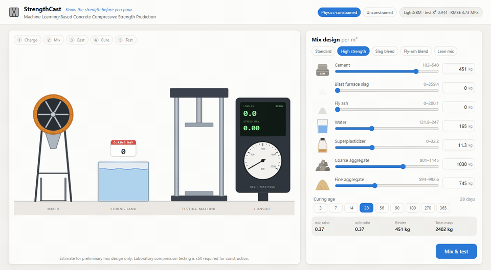
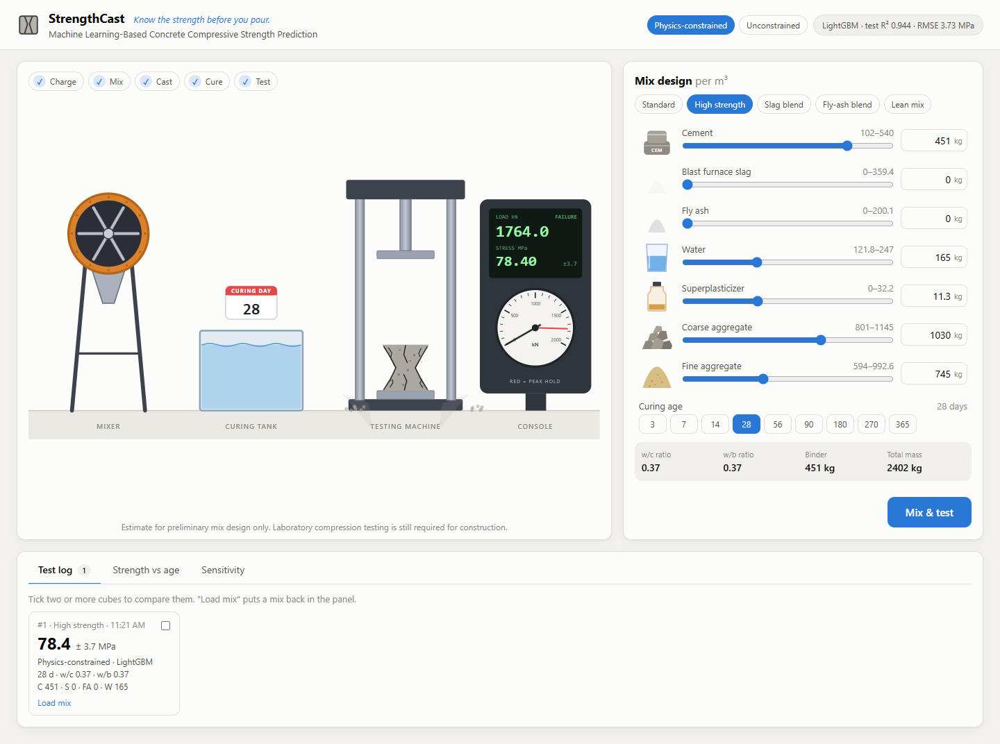
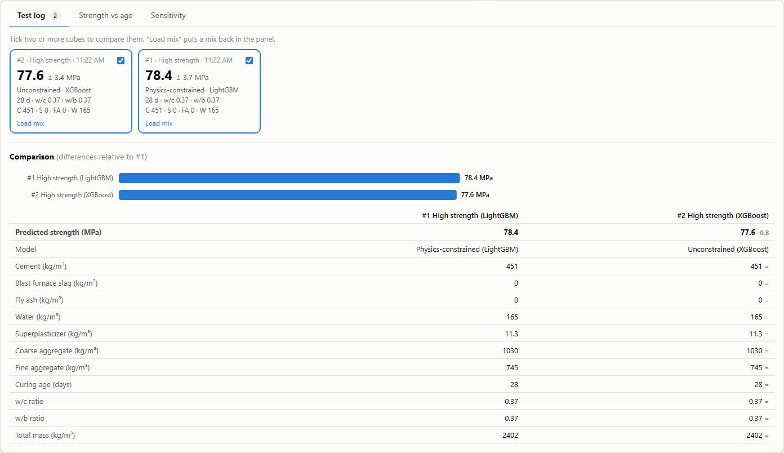
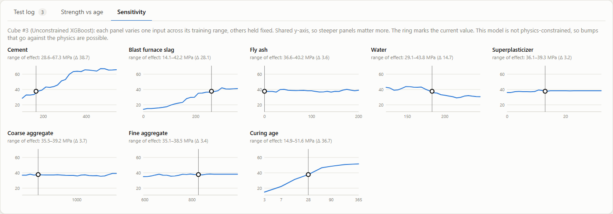
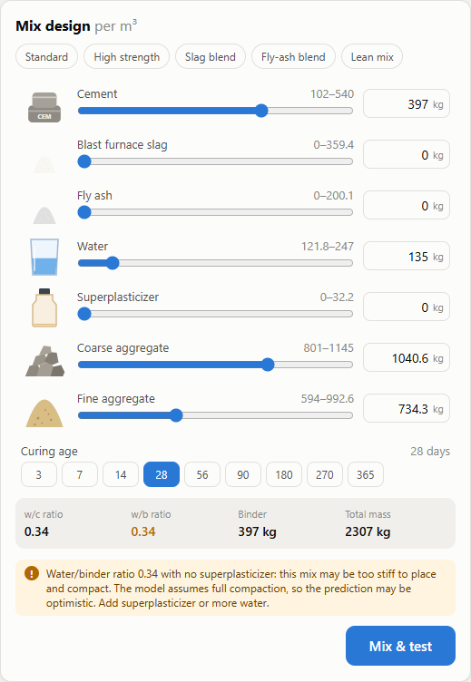
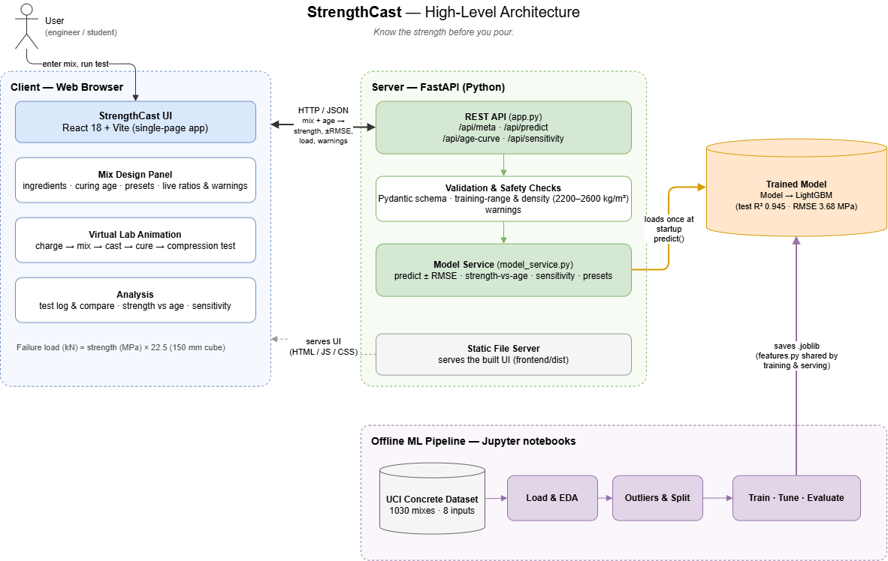

# StrengthCast

### Machine Learning-Based Concrete Compressive Strength Prediction

> ***Know the strength before you pour.***

StrengthCast is a machine-learning decision-support tool for preliminary concrete mix design.
You enter the amount of each ingredient and the curing age, and the app predicts the 150 mm cube
compressive strength in MPa. It then plays the result out as a virtual lab test: the ingredients go
into a mixer, the concrete is cast and cured, and the cube is crushed in a compression machine until
it fails at the predicted load. Two trained models are built in, a **physics-constrained** one and an
**unconstrained** one, each with its own strengths, and you can switch between them from the header.



> [!IMPORTANT]
> Predictions are estimates for **preliminary** mix design and quality assessment. They supplement
> laboratory compression testing and **do not replace it**. Always verify with physical tests before
> using a mix in construction.

---

## Contents

- [Features](#features)
- [Screenshots](#screenshots)
- [How it works](#how-it-works)
- [Model performance](#model-performance) and [two models](#two-models-and-when-to-use-each)
- [Tech stack](#tech-stack)
- [Project structure](#project-structure)
- [Getting started](#getting-started)
- [API](#api)
- [Retraining or switching models](#retraining-or-switching-models)
- [Limitations](#limitations)
- [Dataset and credits](#dataset-and-credits)

---

## Features

- **Mix designer.** Set each of the 7 ingredients with a slider or by typing a value (kg per m³ of
  concrete), and pick a curing age from 3 to 365 days. Each ingredient icon grows or shrinks with its amount.
- **Presets from real mixes.** Five 28-day mixes taken from the dataset: Standard, High strength,
  Slag blend, Fly-ash blend and Lean mix.
- **Animated virtual test.** Charge → Mix → Cast → Cure → Test. The console shows load (kN) and stress
  (MPa) on an LCD and a dial with a peak-hold needle. The cube cracks and fails in the classic hourglass
  shape at the predicted load (failure load in kN = MPa × 22.5 for a 150 mm cube).
- **Live derived values.** Water/cement and water/binder ratios, total binder and total mass update as you type.
- **Input checks.** The app still predicts, but it tells you when not to trust the number blindly:
  - any ingredient or age outside the training data range is flagged as an extrapolation;
  - a total mass outside the realistic 2200–2600 kg/m³ window is flagged;
  - a **water/binder ratio** outside the training range (0.235–0.90) is flagged. Every ingredient can be in
    range while the combination is not;
  - a **dry mix without superplasticizer** (w/b below 0.35 with no SP) gets a workability warning. Such a mix may be
    too stiff to place and compact, so its real strength would fall, but the model assumes full compaction and would
    keep predicting more strength as water drops. The w/b value turns orange when either w/b check fires.
- **Two models, switchable.** A toggle in the header picks the model for the next test:
  **Physics-constrained** (LightGBM) or **Unconstrained** (XGBoost). See [Two models](#two-models-and-when-to-use-each)
  for what each one is good at. Test the same mix with both and compare them side by side.
- **Uncertainty.** Every prediction carries ± the selected model's test RMSE (3.73 MPa constrained, 3.40 MPa
  unconstrained). Hovering the model chip also shows the larger error for brand-new mix designs.
- **Test log and comparison.** Every cube you test is logged with the model that predicted it. Tick two or more
  to compare them side by side, with differences shown against the first.
- **Strength vs age.** For the latest cube, the predicted strength development from 3 to 365 days with
  its error band.
- **Sensitivity analysis.** For the latest cube, one small chart per input, each sweeping that input across
  its training range while the others stay fixed. Steeper charts mean that input matters more for this mix.

## Screenshots

**Main screen after a test.** The stage on the left shows the failed cube and the console reading; the mix
panel on the right holds the inputs.



**Comparing two tested mixes**


**The same mix with both models.** The header toggle switches models; the comparison table shows which model
predicted each cube.



**Strength development with curing age**


**Sensitivity of predicted strength to each input.** Physics-constrained model on top, unconstrained model below,
for the same mix. The constrained curves only ever rise with cement and fall with water; the unconstrained ones
follow the data more closely but can bump the wrong way (here, the water curve rises again between about 135 and
165 kg, and the cement curve wobbles above 450 kg).




**Workability warning.** The Standard mix with water cut to 135 kg and no superplasticizer (w/b 0.34).



## How it works

### Architecture



The app has three parts:

- **Client (web browser):** the React app where you design the mix, watch the virtual test and explore the results.
- **Server (FastAPI):** checks the inputs and runs the selected trained model. The same server also hosts the web page itself.
- **Offline ML pipeline:** Jupyter notebooks that train both models and save each as a `.joblib` file, which the
  server loads once at startup.

Editable source: [`docs/StrengthCast.drawio`](docs/StrengthCast.drawio). Open it in
[diagrams.net](https://app.diagrams.net) or the VS Code Draw.io extension.

### Request flow

1. The frontend sends the 8 raw inputs (7 ingredients in kg/m³ plus age in days) and the selected model
   (`?model=constrained` or `?model=unconstrained`).
2. The backend loads both trained pipelines once at startup and checks the inputs against the training
   ranges, the density window and the water/binder checks.
3. The pipeline's first step (`ConcreteFeatures`) derives the engineered features, so training and serving
   always run the same code.
4. The prediction comes back **before** the animation starts; the animation only reveals it.

### ML pipeline

The notebooks in [`backend/ML/`](backend/ML) form the pipeline and are run in order. See
[`backend/ML/README.md`](backend/ML/README.md) for details.

| Notebook | Purpose |
|---|---|
| `01_Data_Loading` | Load and inspect the raw data (1030 rows, including 25 exact duplicates, so 1005 unique rows from 428 mix designs are used) |
| `02_EDA` | Distributions, correlations, multicollinearity (VIF), strength vs age. Findings: [`docs/EDA_and_Outlier_Insights.md`](docs/EDA_and_Outlier_Insights.md) |
| `03_OutlierDetection` | IQR and z-score checks. All rows are kept: the flagged ones are real high-performance or edge-of-range mixes |
| `04_DataSplit` | Dedupe → 80/20 train/test split and 5 CV folds (stratified by curing age) → engineered features |
| `05_Model` | Baselines (raw vs engineered) → Optuna tuning of the top 3 → physics constraints → test set → new-mix check → save both models |

Key modelling choices:

- **Engineered features:** `log(age)` (straightens the fast-early-gain-then-plateau curve),
  water/binder ratio (the strongest single predictor, r ≈ −0.77 at 28 days), water/cement ratio and total binder.
- **Physics constraints (one of the two models):** the constrained model is monotonically constrained so that
  predicted strength can only rise with age and cement, and only fall with water. The unconstrained model is free.
- **√strength target:** the model learns √strength, and its output is clipped at 0 before squaring, so
  predicted strength can never be negative.

## Model performance

StrengthCast ships **two models** and lets you switch between them. Both use the same engineered features and
are refit on all 1,005 rows after evaluation (files in `backend/ML/models/`).

| Metric | Physics-constrained · LightGBM | Unconstrained · XGBoost |
|---|---|---|
| File | `concrete_strength_model_v3.joblib` | `concrete_strength_model_v3_unconstrained.joblib` |
| Test R² (held-out 20%) | 0.944 | **0.953** |
| Test RMSE | 3.73 MPa | **3.40 MPa** |
| Test MAE | 2.53 MPa | **2.28 MPa** |
| Test predictions within ±5 / ±10 MPa | 87% / 97% | **89% / 98%** |
| 5-fold CV R² / RMSE | **0.928 / 4.35 MPa** | 0.927 / 4.36 MPa |
| **Brand-new mix designs** (grouped-by-mix CV) | R² 0.900 · RMSE 5.07 MPa | **R² 0.909 · RMSE 4.84 MPa** |
| Physics check (428 mixes): falling age curves | **0** | 43 |
| More cement never lowers / more water never raises strength | **100% / 100% of mixes** | 0% / 0% of mixes |

The test split is by row, stratified by age, so the test score means "known mix, new curing age": 74% of test
rows are mixes the model saw at another age. For a brand-new mix design, the grouped-by-mix score is the better
guide: there every row of a mix stays on one side of the split, so the mix is never seen at any age
(`05_Model`, section 6.2). The app's model chip shows both error figures on hover.

### Two models and when to use each

Neither model is better at everything, so both are kept:

| | Physics-constrained (LightGBM) | Unconstrained (XGBoost) |
|---|---|---|
| **Strength** | Always behaves like concrete: strength never falls with curing age or cement, never rises with water | Lowest error: about 0.2–0.3 MPa better on the test set and on new mixes |
| **Weakness** | Slightly less accurate | Can learn bumps from noisy data, e.g. a dip in strength as cement rises, or an age curve that drops |
| **Best for** | What-if questions: sensitivity analysis, strength vs age, comparing small changes to a mix | A single best estimate for a mix similar to those in the dataset |

Practical guidance:

- For a **point estimate**, use either. Testing the same mix with both is a quick check: if they agree within a few MPa,
  the estimate is stable. A large gap means the mix sits where the data is thin, so treat both numbers with caution.
- For **trends** (sensitivity, age curves, "what if I add 20 kg of cement"), prefer the constrained model. The
  unconstrained model's curves show the data's noise as well as its trend.
- Both models assume the concrete is fully compacted. The workability warning applies to both.

The constraints restrict only the **direction** of each constrained input's effect, not its size, so the
constrained model still learns interactions. For example, its gain from 250 → 450 kg of cement grows from about
+18 MPa at 3 days to about +27 MPa at 365 days.

**How the models were chosen** ([`05_Model`](backend/ML/05_Model.ipynb)):

1. **Baselines.** 11 models with default parameters, each on raw and engineered features, scored on 5 CV folds.
   Engineered features improved every model; the boosting models led.
2. **Tuning.** The top 3 (LightGBM, HistGradientBoosting, XGBoost) were tuned with Optuna on the same folds.
3. **Physics constraints.** The tuned unconstrained models failed the physics check (strength falling with age
   in 43–56 mixes; more cement lowering strength somewhere in every mix). The constrained models were re-baselined
   and re-tuned, and all pass it.
4. **Physics-constrained pick:** the lowest CV RMSE among models that pass the physics check (LightGBM).
5. **Unconstrained pick:** LightGBM leads on CV (4.21 vs 4.36 MPa) and the test set is a tie (3.41 vs 3.40 MPa),
   but XGBoost is clearly better on brand-new mixes (4.84 vs 5.02 MPa), which is what the app is for, so XGBoost.
6. **New-mix check.** Grouped-by-mix CV on all 1,005 rows, then both models are refit on all rows and saved.

| Model (engineered features) | Stage | CV R² | CV RMSE | Test R² | Test RMSE | Physics check |
|---|---|---|---|---|---|---|
| Linear Regression | baseline | 0.808 | 7.16 | 0.800 | 7.01 | – |
| KNN | baseline | 0.836 | 6.61 | 0.861 | 5.84 | – |
| SVR | baseline | 0.893 | 5.35 | 0.899 | 4.98 | – |
| Random Forest | baseline | 0.901 | 5.11 | 0.930 | 4.16 | – |
| Extra Trees | baseline | 0.901 | 5.10 | 0.929 | 4.19 | – |
| Gradient Boosting | baseline | 0.904 | 5.04 | 0.923 | 4.35 | – |
| XGBoost | baseline | 0.907 | 4.94 | 0.953 | 3.42 | – |
| LightGBM | baseline | 0.918 | 4.64 | 0.945 | 3.67 | – |
| **XGBoost** | **tuned (unconstrained model in the app)** | **0.927** | **4.36** | **0.953** | **3.40** | fails |
| LightGBM | tuned | 0.931 | 4.21 | 0.953 | 3.41 | fails |
| XGBoost | tuned + constrained | 0.926 | 4.38 | 0.940 | 3.86 | passes |
| **LightGBM** | **tuned + constrained (constrained model in the app)** | **0.928** | **4.35** | **0.944** | **3.73** | **passes** |

On brand-new mix designs (grouped-by-mix CV): unconstrained XGBoost R² 0.909 / RMSE 4.84 MPa, unconstrained
LightGBM 0.903 / 5.02, constrained LightGBM 0.900 / 5.07. The fold-to-fold spread is about ±0.5 MPa, so these
gaps are real but small.

## Tech stack

| Layer | Tools |
|---|---|
| ML | Python 3.10, pandas, NumPy, scikit-learn, LightGBM, XGBoost, Jupyter |
| Backend | FastAPI, Pydantic, Uvicorn, joblib |
| Frontend | React 18, Vite 5. No UI or chart libraries: charts and the animation are hand-written SVG |

## Project structure

```
.
├── backend/
│   ├── app.py               FastAPI app: /api routes + serves the built frontend at /
│   ├── model_service.py     Loads both models, predict, age curve, sensitivity, input checks, presets
│   ├── Data/                Dataset: original UCI .xls + concrete_data.csv (written by 01_Data_Loading)
│   └── ML/
│       ├── 01_…05_*.ipynb   Training pipeline notebooks
│       ├── features.py      Feature engineering shared by training and serving
│       ├── data/            splits.csv: train/test split, CV folds and engineered features
│       ├── models/          Trained model bundles + metrics (loaded by the app)
│       └── archive/         Earlier notebook versions and the legacy CSVs they use
├── frontend/
│   ├── index.html
│   ├── vite.config.js       Dev server on :5173, proxies /api to :8000
│   └── src/
│       ├── App.jsx          State, mix & test flow, test log, tabs, warnings
│       ├── lib/stage.js     SVG animation: mixer, mould, curing tank, compression machine, console
│       ├── lib/mix.js       Derived values and instant client-side warnings
│       └── components/      MixPanel, IngredientIcon, StageView, TestLog, Analysis, charts, Tooltip
├── docs/
│   ├── StrengthCast.drawio  Architecture diagram (editable source) + StrengthCast.png export
│   ├── EDA_and_Outlier_Insights.md   Cell-by-cell findings of 02_EDA and 03_OutlierDetection
│   └── images/              README screenshots and demo GIF
└── requirements.txt
```

## Getting started

### Prerequisites

- Python 3.10
- Node.js 18 or newer (for building the frontend)

### 1. Install the Python dependencies

```bash
python -m venv .venv
# Windows (PowerShell):  .venv\Scripts\Activate.ps1
# Windows (Git Bash):    source .venv/Scripts/activate
# macOS / Linux:         source .venv/bin/activate
pip install -r requirements.txt
```

The library versions are pinned because the saved models are pickled scikit-learn/LightGBM/XGBoost pipelines,
which need compatible versions to load.

### 2. Build the frontend

```bash
cd frontend
npm install
npm run build        # writes frontend/dist, which the backend serves
cd ..
```

### 3. Run the app

```bash
cd backend
uvicorn app:app --reload
```

Open **http://127.0.0.1:8000**. FastAPI's interactive API docs are at http://127.0.0.1:8000/docs.

### Frontend development (hot reload)

Keep the backend running, then in a second terminal:

```bash
cd frontend
npm run dev
```

Open http://localhost:5173. Vite forwards `/api` calls to the backend on port 8000. After frontend changes,
run `npm run build` again so that the backend serves the new version.

## API

Every POST body is one flat JSON object: the 7 ingredients in kg/m³ plus `age` in days.

```json
{
  "cement": 397, "blast_furnace_slag": 0, "fly_ash": 0, "water": 185.7,
  "superplasticizer": 0, "coarse_aggregate": 1040.6, "fine_aggregate": 734.3, "age": 28
}
```

The POST routes take an optional `?model=` query parameter: `constrained` (default) or `unconstrained`,
for example `POST /api/predict?model=unconstrained`.

| Method | Path | Returns |
|---|---|---|
| GET | `/api/meta` | Input ranges and steps, ages, presets, density window, w/b range and dry-mix threshold, and `models` (key, label, algorithm, constrained, metrics) with `default_model` |
| POST | `/api/predict` | `strength_mpa`, `low_mpa` / `high_mpa` (± the model's test RMSE), `failure_load_kn`, derived ratios, `warnings` |
| POST | `/api/age-curve` | `[{ "age": …, "strength_mpa": … }]` for 3–365 days |
| POST | `/api/sensitivity` | For each input, a sweep across its training range with the others held fixed |
| GET | `/api/health` | Status and the algorithm behind each model |

Out-of-range inputs are still predicted, but the response includes warnings. Missing fields, a zero or
negative cement or water value, or an unknown model name are rejected with a 422 error.

## Retraining or switching models

1. Run the notebooks in `backend/ML/` in order. `05_Model.ipynb` saves both bundles to `backend/ML/models/`:
   `concrete_strength_model_v3.joblib` (constrained) and `concrete_strength_model_v3_unconstrained.joblib`.
2. The backend loads models straight from that folder. `MODELS` at the top of
   [`backend/model_service.py`](backend/model_service.py) maps each key to its file and label, and `DEFAULT_MODEL`
   picks the one selected at start-up. If the unconstrained file is missing, the app runs with the constrained one only.
3. Restart the server.

## Limitations

- **Trained on 1,005 mixes.** Predictions are only meaningful inside the ranges of that data
  (for example cement 102–540 kg/m³, water 121.75–247 kg/m³, age 1–365 days). The app flags anything outside them.
- **No physical properties beyond the mix.** Cement type, aggregate shape and grading, curing temperature,
  compaction and admixture chemistry are not inputs, so two mixes with the same proportions can still differ in reality.
- **Full compaction is assumed.** The dataset has no workability (slump) data, so neither model can tell when a
  mix is too dry to place. Because of its physics constraint, the constrained model always predicts more strength
  for less water.
  Real high-strength concrete reaches low w/b with superplasticizer: every training mix below w/b 0.28 uses it.
  The app warns when w/b is below 0.35 without superplasticizer.
- **Sensitivity curves show model behaviour.** Changing one ingredient while holding the others fixed can
  produce mixes that wouldn't exist in practice, and tree models give stepped curves. Read the trend, not each step.
  With the unconstrained model, a step can even go the wrong way.
- **Age 1 day is not offered**, because the data has only 2 one-day samples.

## Dataset and credits

The data is the **Concrete Compressive Strength** dataset from the UCI Machine Learning Repository
(1,030 samples, 8 inputs, strength in MPa), donated by Prof. I-Cheng Yeh.
