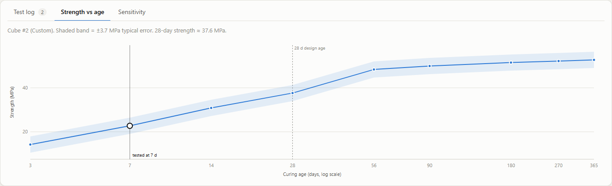
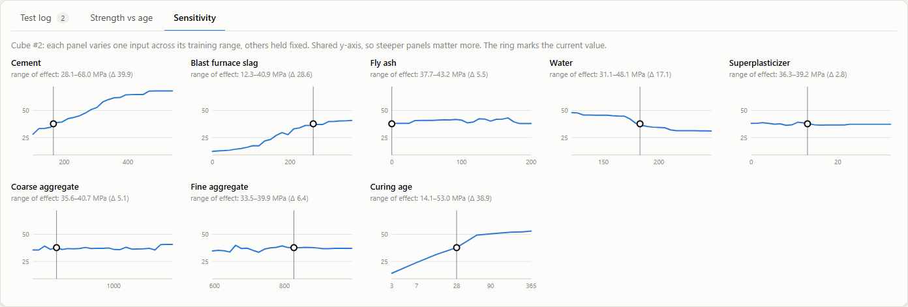

# StrengthCast

### Machine Learning-Based Concrete Compressive Strength Prediction

> ***Know the strength before you pour.***

StrengthCast is a machine-learning decision-support tool for preliminary concrete mix design.
You enter the amount of each ingredient and the curing age, and the app predicts the 150 mm cube
compressive strength in MPa. It then plays the result out as a virtual lab test: the ingredients go
into a mixer, the concrete is cast and cured, and the cube is crushed in a compression machine until
it fails at the predicted load.


> [!IMPORTANT]
> Predictions are estimates for **preliminary** mix design and quality assessment. They supplement
> laboratory compression testing and **do not replace it**. Always verify with physical tests before
> using a mix in construction.

---

## Contents

- [Features](#features)
- [Screenshots](#screenshots)
- [How it works](#how-it-works)
- [Model performance](#model-performance)
- [Tech stack](#tech-stack)
- [Project structure](#project-structure)
- [Getting started](#getting-started)
- [API](#api)
- [Retraining or switching the model](#retraining-or-switching-the-model)
- [Limitations](#limitations)
- [Dataset and credits](#dataset-and-credits)

---

## Features

- **Mix designer.** Set each of the 7 ingredients with a slider or by typing a value (kg per m³ of
  concrete), and pick a curing age from 3 to 365 days. Each ingredient icon grows or shrinks with its amount.
- **Presets from real mixes.** Five 28-day mixes taken from the dataset: Standard, High strength,
  Slag blend, Fly-ash blend and Lean mix.
- **Animated virtual test.** Charge → Mix → Cast → Cure → Test. The console shows load (kN) and stress
  (MPa) on an LCD and a dial with a peak-hold needle. The cube cracks and fails in the classic hourglass
  shape at the predicted load (failure load in kN = MPa × 22.5 for a 150 mm cube).
- **Live derived values.** Water/cement and water/binder ratios, total binder and total mass update as you type.
- **Input checks.** Any value outside the training data range is flagged as an extrapolation, and a total
  mass outside the realistic 2200–2600 kg/m³ window is also flagged. The app still predicts, but it tells
  you not to trust the number blindly.
- **Uncertainty.** Every prediction carries ± the model's test RMSE.
- **Test log and comparison.** Every cube you test is logged. Tick two or more to compare them side by
  side, with differences shown against the first.
- **Strength vs age.** For the latest cube, the predicted strength development from 3 to 365 days with
  its error band.
- **Sensitivity analysis.** For the latest cube, one small chart per input, each sweeping that input across
  its training range while the others stay fixed. Steeper charts mean that input matters more for this mix.
- **Live estimate** (optional). The predicted strength updates while you drag the sliders, without running
  the animation.

## Screenshots

**Main screen after a test.** The stage on the left shows the failed cube and the console reading; the mix
panel on the right holds the inputs.


**Comparing two tested mixes**


**Strength development with curing age**



**Sensitivity of predicted strength to each input**



## How it works

### Architecture


The app has three parts:

- **Client (web browser):** the React app where you design the mix, watch the virtual test and explore the results.
- **Server (FastAPI):** checks the inputs and runs the trained model. The same server also hosts the web page itself.
- **Offline ML pipeline:** Jupyter notebooks that train the model and save it as a `.joblib` file, which the
  server loads once at startup.

Editable source: [`docs/StrengthCast.drawio`](docs/StrengthCast.drawio). Open it in
[diagrams.net](https://app.diagrams.net) or the VS Code Draw.io extension.

### Request flow

1. The frontend sends the 8 raw inputs: 7 ingredients in kg/m³ plus age in days.
2. The backend loads the trained pipeline once at startup and checks the inputs against the training
   ranges and the density window.
3. The pipeline's first step (`ConcreteFeatures`) derives the engineered features, so training and serving
   always run the same code.
4. The prediction comes back **before** the animation starts; the animation only reveals it.

### ML pipeline

The notebooks in [`backend/ML/`](backend/ML) form the pipeline and are run in order. See
[`backend/ML/README.md`](backend/ML/README.md) for details.

| Notebook | Purpose |
|---|---|
| `01_Data_Loading` | Load and inspect the raw data (1030 rows, including 25 exact duplicates, so 1005 unique mixes are used) |
| `02_EDA` | Distributions, correlations, multicollinearity (VIF), strength vs age |
| `03_OutlierDetection` | IQR and z-score checks. All rows are kept: the flagged ones are real high-performance or edge-of-range mixes |
| `04_DataSplit` | 80/20 train/test split and 5 CV folds, stratified by curing age |
| `05_Model` | Compare models, apply physics constraints, tune, select, evaluate, save |

Key modelling choices:

- **Engineered features:** `log(age)` (straightens the fast-early-gain-then-plateau curve),
  water/binder ratio (the strongest single predictor, r ≈ −0.77 at 28 days), water/cement ratio and total binder.
- **Physics constraints:** the model is monotonically constrained so that predicted strength can only
  rise with age and cement, and only fall with water.
- **√strength target:** the model learns √strength, and its output is clipped at 0 before squaring, so
  predicted strength can never be negative.

## Model performance

Selected model: **LightGBM** with engineered features and monotonic constraints
(`backend/ML/models/concrete_strength_model_v2.joblib`).

| Metric | Value |
|---|---|
| Test R² (held-out 20%) | **0.945** |
| Test RMSE | 3.68 MPa |
| Test MAE | 2.45 MPa |
| 5-fold CV R² | 0.930 |
| Repeated CV R² | 0.934 ± 0.001 |
| Grouped-by-mix CV R² (completely new mix designs) | 0.900 (RMSE 5.16 MPa) |

The test split is by row, stratified by age, so the test score means "known mix, new curing age". The
grouped-by-mix score is the better guide for a brand-new mix design.

Cross-validated R² of the candidate models (engineered features):

| Model | CV R² | CV RMSE (MPa) |
|---|---|---|
| Ridge | 0.809 | 7.17 |
| KNN | 0.870 | 5.93 |
| SVR (RBF) | 0.879 | 5.70 |
| Random Forest | 0.904 | 5.09 |
| Extra Trees | 0.908 | 4.99 |
| XGBoost | 0.926 | 4.45 |
| LightGBM | 0.926 | 4.46 |
| Gradient Boosting | 0.928 | 4.40 |
| **LightGBM, tuned + constrained (selected)** | **0.930** | **4.33** |

Full results: [`model_comparison_v2.csv`](backend/ML/models/model_comparison_v2.csv) and
[`final_metrics_v2.json`](backend/ML/models/final_metrics_v2.json).

## Tech stack

| Layer | Tools |
|---|---|
| ML | Python 3.10, pandas, NumPy, scikit-learn, LightGBM, XGBoost, Jupyter |
| Backend | FastAPI, Pydantic, Uvicorn, joblib |
| Frontend | React 18, Vite 5. No UI or chart libraries: charts and the animation are hand-written SVG |

## Project structure

```
.
├── backend/
│   ├── app.py               FastAPI app: /api routes + serves the built frontend at /
│   ├── model_service.py     Model loading, predict, age curve, sensitivity, input checks, presets
│   ├── Data/                Dataset (raw .xls, CSV, fold split)
│   └── ML/
│       ├── 01_…05_*.ipynb   Training pipeline notebooks
│       ├── features.py      Feature engineering shared by training and serving
│       ├── data/            Saved train/test/fold assignment
│       ├── models/          Trained model bundles + metrics (loaded by the app)
│       └── archive/         Earlier notebook versions
├── frontend/
│   ├── index.html
│   ├── vite.config.js       Dev server on :5173, proxies /api to :8000
│   └── src/
│       ├── App.jsx          State, mix & test flow, test log, tabs, warnings
│       ├── lib/stage.js     SVG animation: mixer, mould, curing tank, compression machine, console
│       ├── lib/mix.js       Derived values and instant client-side warnings
│       └── components/      MixPanel, IngredientIcon, StageView, TestLog, Analysis, charts, Tooltip
├── docs/
│   ├── StrengthCast.drawio  Architecture diagram (editable source) + StrengthCast.png export
│   └── images/              README screenshots and demo GIF
└── requirements.txt
```

## Getting started

### Prerequisites

- Python 3.10
- Node.js 18 or newer (for building the frontend)

### 1. Install the Python dependencies

```bash
python -m venv .venv
# Windows (PowerShell):  .venv\Scripts\Activate.ps1
# Windows (Git Bash):    source .venv/Scripts/activate
# macOS / Linux:         source .venv/bin/activate
pip install -r requirements.txt
```

The library versions are pinned because the saved model is a pickled scikit-learn/LightGBM pipeline,
which needs compatible versions to load.

### 2. Build the frontend

```bash
cd frontend
npm install
npm run build        # writes frontend/dist, which the backend serves
cd ..
```

### 3. Run the app

```bash
cd backend
uvicorn app:app --reload
```

Open **http://127.0.0.1:8000**. FastAPI's interactive API docs are at http://127.0.0.1:8000/docs.

### Frontend development (hot reload)

Keep the backend running, then in a second terminal:

```bash
cd frontend
npm run dev
```

Open http://localhost:5173. Vite forwards `/api` calls to the backend on port 8000. After frontend changes,
run `npm run build` again so that the backend serves the new version.

## API

Every POST body is one flat JSON object: the 7 ingredients in kg/m³ plus `age` in days.

```json
{
  "cement": 397, "blast_furnace_slag": 0, "fly_ash": 0, "water": 185.7,
  "superplasticizer": 0, "coarse_aggregate": 1040.6, "fine_aggregate": 734.3, "age": 28
}
```

| Method | Path | Returns |
|---|---|---|
| GET | `/api/meta` | Input ranges and steps, ages, presets, model metrics, density window |
| POST | `/api/predict` | `strength_mpa`, `low_mpa` / `high_mpa` (± test RMSE), `failure_load_kn`, derived ratios, `warnings` |
| POST | `/api/age-curve` | `[{ "age": …, "strength_mpa": … }]` for 3–365 days |
| POST | `/api/sensitivity` | For each input, a sweep across its training range with the others held fixed |
| GET | `/api/health` | Status and model name |

Out-of-range inputs are still predicted, but the response includes warnings. Missing fields, or a zero or
negative cement or water value, are rejected with a 422 error.

## Retraining or switching the model

1. Run the notebooks in `backend/ML/` in order. `05_Model.ipynb` saves the bundle to `backend/ML/models/`.
2. The backend loads models straight from that folder. To use a different file, change `MODEL_FILE` at the
   top of [`backend/model_service.py`](backend/model_service.py).
3. Restart the server.

## Limitations

- **Trained on 1,005 mixes.** Predictions are only meaningful inside the ranges of that data
  (for example cement 102–540 kg/m³, water 121.75–247 kg/m³, age 1–365 days). The app flags anything outside them.
- **No physical properties beyond the mix.** Cement type, aggregate shape and grading, curing temperature,
  compaction and admixture chemistry are not inputs, so two mixes with the same proportions can still differ in reality.
- **Sensitivity curves show model behaviour.** Changing one ingredient while holding the others fixed can
  produce mixes that wouldn't exist in practice, and tree models give stepped curves. Read the trend, not each step.
- **Age 1 day is not offered**, because the data has only 2 one-day samples.

## Dataset and credits

The data is the **Concrete Compressive Strength** dataset from the UCI Machine Learning Repository
(1,030 samples, 8 inputs, strength in MPa), donated by Prof. I-Cheng Yeh.
